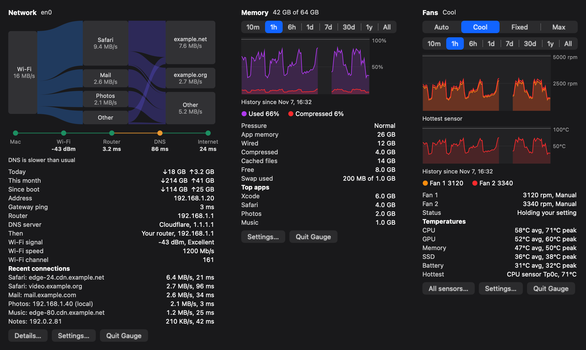
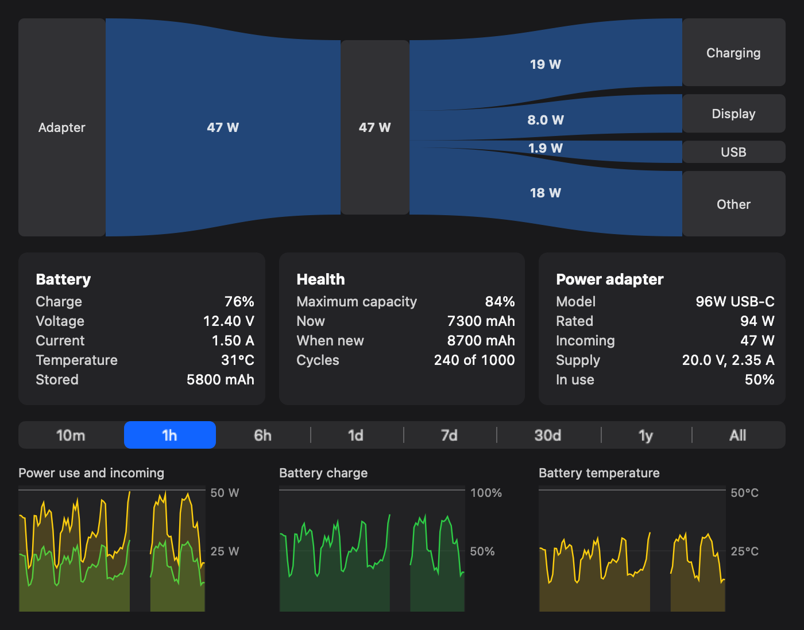
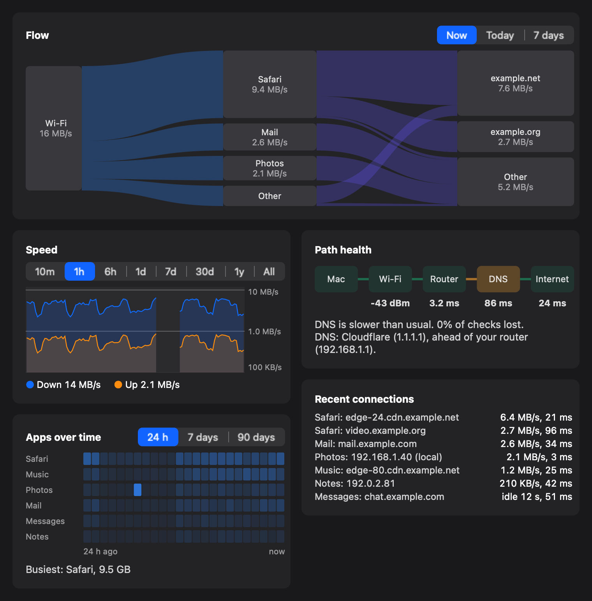
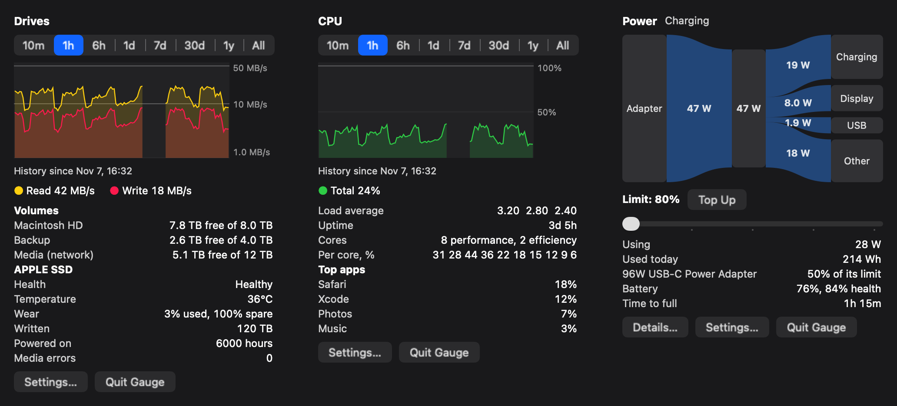
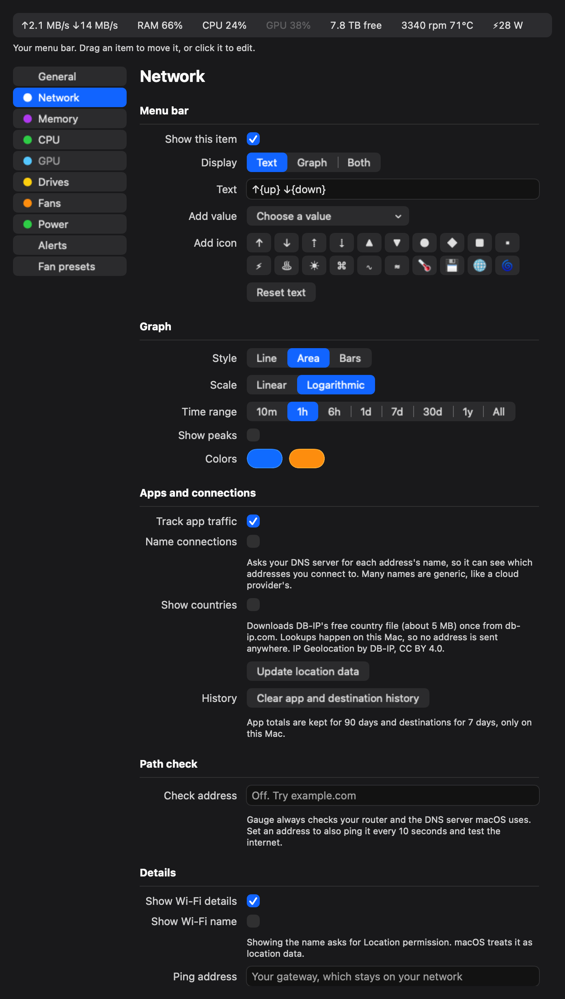
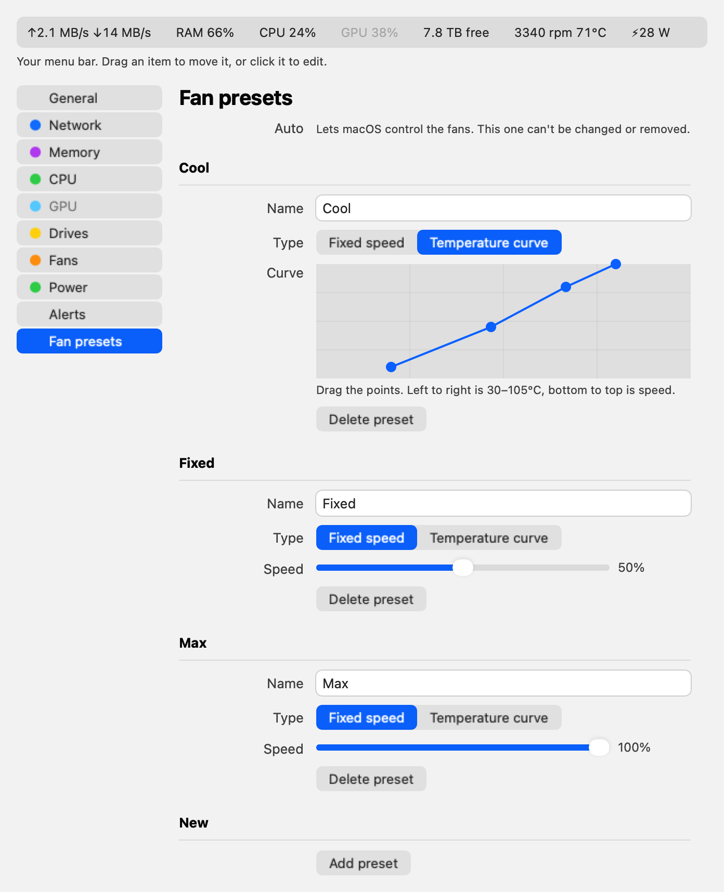

# Gauge

A macOS menu bar system monitor written in Rust. It shows network speed, RAM, CPU, drives and fans in the menu bar. Click an item for a history graph and details.



*Images are drawn by the app using sample data.*

> **Fan control can overheat or damage your Mac if used wrongly.** It uses undocumented Apple interfaces and is provided with no warranty.

## Status

Tested on one machine only: an M1 Max MacBook Pro on macOS 27. Other Macs are untested, and fan control is expected to fail on many of them:

- The helper refuses to run on Macs with the `Ftst` key, which reportedly includes M3 and M4 models.
- Macs that use the lowercase `F0md` key, reportedly the M5, aren't supported.
- Intel Macs aren't supported.

On that Mac, fan control has been tested with both fans moving between 2,000 and 4,000 rpm, and with the return to Auto after a disconnect, a hang, a killed app and a crashed helper. Temperature curves have only run under heavy load, so their behavior at low temperatures hasn't been tested. The charge limit has been tested being set and cleared, with macOS's power manager (`pmset -g battlimit`) showing each change, but it hasn't yet been tested stopping a real charge.

## Features

- **Network:** a flow diagram from your connection to apps to where their traffic goes, with soft points of light drifting along it while data moves. Also live speed, data used today and this month, Wi-Fi signal, the DNS server in use, recent connections, and a check of each step to the internet. The menu bar item keeps a steady width so the items beside it don't shift
- **Network window:** the flow now, today or over 7 days, speed history, which apps used the network hour by hour for up to 90 days, path health with the DNS server in use, and recent connections, which stay listed for a minute after they go quiet
- **Memory:** pressure, app, wired, compressed, cached, swap, and top apps
- **CPU and GPU:** total and per-core load, load average, GPU use, and top apps
- **Drives:** free space, read and write speed, and NVMe health
- **Fans:** live speed, temperature, and presets you can add, rename and delete, with fixed speeds or temperature curves
- **Sensors:** a window listing every temperature, power, voltage and current reading. Named sensors are from community research and apply to M1 chips; the rest keep their raw codes
- **Power:** a diagram of power flowing from the adapter and battery to the display, USB, charging and the rest of the Mac, plus a window with adapter details, battery health, and graphs
- **Countries:** an optional setting that shows which country each connection goes to, using [DB-IP](https://db-ip.com)'s free country file
- **Charge limit:** sets the limit built into macOS 27, from 80% to 100%, with Top Up to charge to full once. It doesn't need the fan helper, and Gauge doesn't touch battery hardware directly
- **Graphs:** ranges from 10 minutes to All, which grows with the saved history, with line, area or bar styles
- **Menu bar:** edit what each item says, add icons, adjust the spacing, and drag items into any order
- **Alerts:** low disk space, high temperature, memory pressure and lost connection
- **Command line:** `gauge` prints every reading as JSON

## Screenshots

The Power window, with power flow, battery and adapter details:



The Network window, with the flow, app timeline and path check:



Drives, CPU and Power panels:



Settings has a live copy of your menu bar. Drag an item to move it, or click it to edit:



Fan presets, each a fixed speed or a draggable temperature curve, in light mode:



To regenerate these with sample data:

```bash
target/release/gauge-app --render gallery network,memory,fans docs/images/panels-dark.png dark
```

## Install

Requires a Rust toolchain and the Xcode command line tools.

```bash
scripts/bundle.sh
open ~/Applications/Gauge.app
```

The bundle gets an ad-hoc signature, so it runs on the Mac that built it but isn't notarized for sharing.

## Fan helper

Monitoring needs no special permissions. Changing fan speed needs a small root helper. To install it, choose a preset other than Auto in the Fans panel, then click **Install fan helper…**.

To remove it:

```bash
sudo /Library/PrivilegedHelperTools/com.gauge.fand-uninstall
```

The helper accepts connections only from the user who installed it. It always clamps speeds to each fan's own limits, so a fan can't be stopped. It returns fans to Auto when:

- Gauge quits, crashes or stops responding for 5 seconds
- temperatures stay above 100°C, or every sensor stops reading
- the helper starts or stops, including after a crash

Fans also start on Auto every time Gauge launches.

**Security limits:** the helper accepts only speeds within each fan's limits, and other users on the Mac can't reach it. Anything already running as your user can use it to change fan speeds within those limits. The installer copies the helper into a root-owned folder before checking or starting it, and only installs it for the account logged in at the screen. The installer script itself still runs from `~/Applications`, so malware running as your user could swap it before you enter your password, which would give it root. Fixing that needs a signed installer from a paid Apple Developer account, which Gauge doesn't have yet. Only install the helper on a Mac you trust, from source you've built yourself.

## Privacy

Nothing is sent anywhere by default.

Per-app traffic comes from Apple's `nettop` and stays on this Mac. Which apps used the network is kept for 90 days, and which addresses they connected to is kept for 7 days. Settings has a button to clear both, and a switch to stop tracking apps. Countries are off by default. Turning them on downloads DB-IP's free country file (about 5 MB) once from db-ip.com, and Settings can update it. Lookups happen on this Mac, so no address is sent anywhere. Connection names are off by default, because looking up a name tells your DNS server which address you connected to. The path check pings your router, and every 10 seconds asks the DNS server macOS uses about the root zone, a question that says nothing about you. Settings shows which DNS server that is and what set it, such as a VPN. The internet step only runs once you set a check address, which Gauge then pings every 10 seconds.

The Wi-Fi network name is off by default, because macOS treats it as location data and asks for Location permission. History and settings stay in `~/Library/Application Support/Gauge`. Hourly speed and sensor history is kept forever, which costs a few MB a year. Gauge pings your local gateway unless you set another address, and it has no analytics or update checks.

## Layout

| Crate | Purpose |
|---|---|
| `smc` | Reads and writes Apple SMC keys |
| `gauge-core` | Collectors, history, settings and fan curves |
| `gauge` | Command-line tool |
| `gauge-app` | Menu bar app, built on AppKit through `objc2` |
| `fan-proto` | Helper protocol and safety rules |
| `gauge-fand` | Root fan helper |
| `fan-spike` | One-off test tool for fan writes |

Run the tests with `cargo test --workspace`. Some tests read real hardware, and the fan helper's watchdog tests need a Mac with fans.

## Credits

IP Geolocation by [DB-IP](https://db-ip.com), used under [CC BY 4.0](https://creativecommons.org/licenses/by/4.0/). The file is downloaded when you turn countries on, not included here.

## License

GNU General Public License v3.0 or later. See [LICENSE](LICENSE). Anyone who distributes a modified version must also share its source under the same license.
